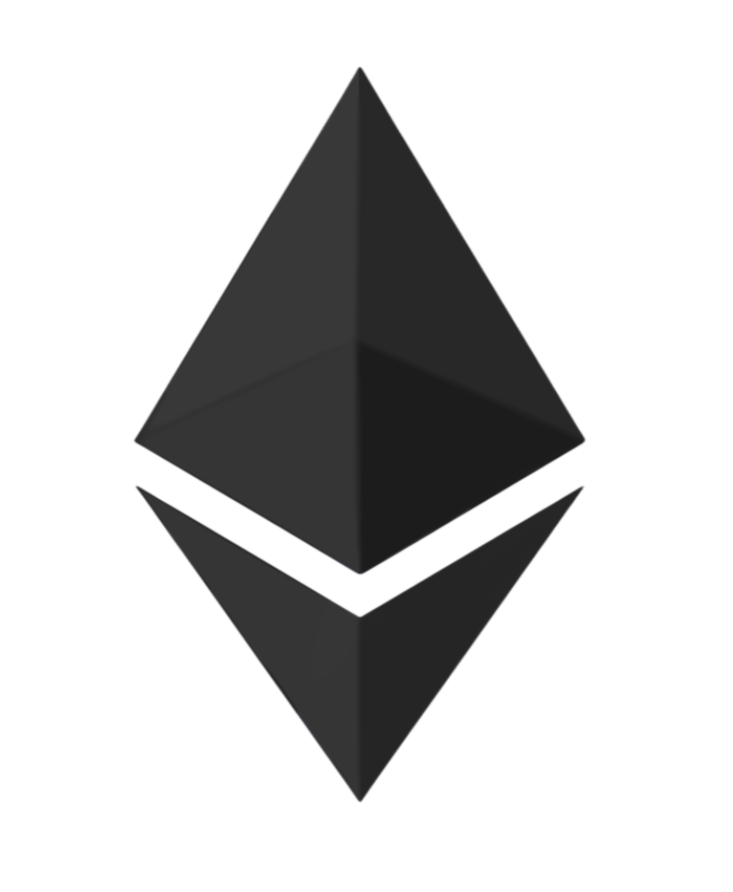

Arklum

<p align="center">
  
</p><h1 align="center">Arklum</h1><p align="center">
  A self-hosted Discord bot dashboard for messaging, voice communication, server management, and extensible tools.
</p><p align="center">
  
  
  
  
</p>---

Arklum is a self-hosted Discord bot management application that combines a Discord bot account with a browser-based dashboard.

It brings messaging, direct messages, voice communication, server management, webhooks, and plugin-powered functionality into one application.

Instead of managing everything through Discord's interface or separate tools, Arklum provides a centralized environment for interacting with and managing a Discord bot.

Arklum is designed around bot accounts, not user accounts. It does not log in to ordinary Discord user accounts or operate as a self-bot.

Contents

- "Features" (#features)
- "Architecture" (#architecture)
- "Requirements" (#requirements)
- "Installation" (#installation)
- "Discord Bot Setup" (#discord-bot-setup)
- "Configuration" (#configuration)
- "Running Arklum" (#running-arklum)
- "Network Access and Security" (#network-access-and-security)
- "Updating" (#updating)
- "Project Structure" (#project-structure)
- "Troubleshooting" (#troubleshooting)
- "Development" (#development)
- "License" (#license)

Features

Messaging and Conversations

- Send, edit, and delete Discord messages.
- Browse guild channels and bot direct messages.
- Reply to messages and work with threads.
- Add and manage reactions.
- View message history and attachments.
- Render formatted message content.
- Preview supported media and attachments.

Voice Communication

- Join Discord voice channels directly through the dashboard.
- Stream microphone audio from the browser to Discord.
- Receive and play audio from Discord voice channels.
- Send supported audio files as native Discord voice messages.
- FFmpeg integration for audio conversion.

Server and Bot Management

- Browse guilds, channels, members, and server information.
- Access channel and role management operations.
- Work with permissions and other supported server operations.
- Manage bot presence and application-related settings.
- Save and manage multiple bot connections.

Available functionality depends on the connected bot's permissions, enabled Gateway intents, and Discord API capabilities.

Additional Tools

- Standalone chat-site functionality.
- Webhook management studio.
- Plugin loading and marketplace integration.
- Theme and font customization.
- Interface customization.
- Utility features.
- Application update and maintenance tools.

Architecture

Arklum uses a modular Node.js architecture with a browser-based frontend.

The backend runs in a single Node.js process and communicates with Discord through Discord.js. The dashboard is served by the same application and communicates with the backend through Socket.IO.

The frontend uses standard HTML, CSS, and JavaScript. No separate frontend build process is required.

Browser
   |
   | HTTP
   v
Arklum Dashboard
   |
   | Socket.IO
   v
Node.js Application
   |
   +-- Discord.js Client
   |      |
   |      +-- Discord API and Gateway
   |
   +-- Feature Modules
   |
   +-- Plugin System
   |
   +-- Local Application Data

Technology Stack

Component| Technology
Runtime| Node.js
Discord integration| Discord.js v14
Backend| JavaScript
Frontend| HTML, CSS, Vanilla JavaScript
Real-time communication| Socket.IO
Voice communication| Discord voice libraries
Audio conversion| FFmpeg
Extensions| Custom plugin system

Requirements

Before installing Arklum, ensure the following are available:

- Node.js 18 or newer.
- npm.
- Git (required for the built-in updater).
- FFmpeg (required for native voice-message audio conversion).

FFmpeg is optional for starting the application. However, native voice-message conversion requires FFmpeg to be available.

Arklum checks for a bundled "ffmpeg-static" executable when available and otherwise looks for "ffmpeg" on the system PATH.

Installation

1. Clone the repository

git clone https://github.com/wasgto3/arklum.git
cd arklum

2. Install dependencies

npm install

3. Start Arklum

npm start

The application initializes its local runtime state directory when needed.

Discord Bot Setup

Arklum requires a Discord bot token to establish its connection with Discord.

1. Create a Discord application

Visit the "Discord Developer Portal" (https://discord.com/developers/applications) and create a new application.

2. Add a bot

Open the application's Bot settings and create its bot user.

3. Configure Gateway intents

Enable the privileged intents required by your intended functionality.

Review the following:

- Message Content Intent
- Server Members Intent
- Presence Intent

Not every feature requires all three. Enable only the intents needed by your intended usage.

4. Invite the bot

Generate an OAuth2 invitation URL with the appropriate bot permissions and add the bot to your server.

Grant only the permissions required for the operations you intend to use.

5. Connect the bot to Arklum

1. Start Arklum.
2. Open the dashboard.
3. Use the bot/token connection interface.
4. Provide your bot token.
5. Verify and connect the bot.

Arklum manages the connection through its dashboard.

Token security: Treat your Discord bot token as a password. Never commit it to Git, embed it in publicly accessible source code, or share it in screenshots or logs. If exposed, reset it through the Discord Developer Portal.

Configuration

Arklum supports the following environment variables:

Variable| Default| Description
"HOST"| "0.0.0.0"| Network interface used by the HTTP server.
"PORT"| "8000"| HTTP server port.

The application does not load a ".env" file in the inspected implementation. Configure these variables through your operating system or process manager.

Windows Command Prompt

set HOST=0.0.0.0
set PORT=8000
npm start

These settings apply to the current Command Prompt session.

Linux, macOS, and Termux

HOST=0.0.0.0 PORT=8000 npm start

Running Arklum

After starting the application, open the dashboard in your browser:

http://localhost:8000

Accessing from another device

Arklum can be accessed from other devices connected to the same network.

Use the local IP address of the machine running Arklum:

http://<host-lan-ip>:8000

Replace "<host-lan-ip>" with the appropriate local network address.

Ensure the host firewall allows incoming connections on the configured port.

Network Access and Security

Arklum defaults to "0.0.0.0", allowing its HTTP server to listen on available network interfaces.

This supports accessing the dashboard from other devices, but it also means that devices capable of reaching the host and port may be able to connect.

Do not expose an unmodified Arklum instance directly to the public internet.

The inspected implementation does not provide a complete server-side authentication and authorization boundary for dashboard access. Browser-side login screens and route guards should not be treated as backend access control.

Before allowing access beyond a trusted network:

- Configure a proper authentication layer or secure access gateway.
- Restrict incoming connections using firewall rules.
- Avoid unnecessary router port forwarding.
- Use HTTPS when traffic crosses networks you do not fully trust.
- Keep bot tokens and the ".arklum_sys/" directory private.
- Only install plugins from sources you trust.

Plugin Security

Plugins execute within the main Node.js process and are not isolated sandboxes.

A plugin may have access to capabilities available to the application process. Only install and execute code from sources you trust.

Local Token Storage

The inspected token-vault implementation uses repeating-key XOR transformation.

This is obfuscation, not modern authenticated encryption. Protect the machine and application data directory accordingly.

Updating

Arklum includes a command-line updater for maintaining the application.

Command| Description
"npm run upd"| Check the configured upstream version.
"npm run update"| Download and apply an available update.
"npm run repair"| Force a fresh update overlay.
"npm run rollback"| Restore files from the latest updater backup.

The updater is configured to use the "main" branch of the "wasgto3/arklum" repository.

It creates backups before applying its update overlay.

Before updating:

- Review your local modifications.
- Keep independent backups of important application data.
- Avoid interrupting an update while files are being replaced.
- Retain updater backups until the installation has been verified.

The updater preserves selected local state and plugin paths, but it should not replace an independent backup strategy.

Additional Commands

npm run bot

Starts "bot.js" directly without the process supervisor used by "npm start".

For maintainers:

npm run ship

This command increments the patch version, stages changes, creates a Git commit, and pushes it.

Review the working tree and staged changes before using it.

Project Structure

arklum/
├── bot.js
├── package.json
├── package-lock.json
├── arklum.png
│
├── modules/
│   ├── commands/
│   ├── chat.js
│   ├── dms.js
│   ├── utility.js
│   ├── status.js
│   ├── devportal.js
│   ├── updater.js
│   ├── chatsite.js
│   ├── webhooks_site.js
│   └── ...
│
├── plugins/
│   ├── loader.js
│   ├── api.js
│   ├── api_v2.js
│   └── marketplace.js
│
├── scripts/
│   ├── supervise.js
│   ├── ensure-deps.js
│   ├── 1kd.js
│   └── ship.js
│
└── static/
    ├── arklum.html
    ├── chatsite.html
    ├── webhooks-studio.html
    ├── core/
    ├── pages/
    ├── shell/
    └── css/

Directory Responsibilities

Path| Responsibility
"bot.js"| Application entry point, Discord client, HTTP server, Socket.IO, and shared runtime state.
"modules/"| Backend feature modules and Discord operations.
"modules/commands/"| Guild, channel, profile, token, plugin, and system command handlers.
"plugins/"| Plugin loader, plugin APIs, and marketplace integration.
"static/"| Browser dashboard and standalone web interfaces.
"scripts/"| Process supervision, dependency checks, updating, rollback, and release helpers.
".arklum_sys/"| Runtime-generated configuration, token state, and updater data. Keep private.

Troubleshooting

Dashboard does not open

- Confirm that Arklum is still running.
- Check the terminal output for the configured host and port.
- Verify that the selected port is not already in use.
- If accessing from another device, verify the host LAN IP and firewall rules.

Bot connection fails

- Verify that the token belongs to a Discord bot application.
- Reset the token if it may have been exposed.
- Confirm that the bot has been invited to the intended server.
- Check enabled Gateway intents.
- Verify that the bot has the necessary server permissions.
- Review the terminal output for Discord login errors.

Messages or server information are missing

- Check the bot's channel and server permissions.
- Confirm that the required Gateway intents are enabled.
- Remember that Discord only exposes information the bot is permitted to access.

Native voice messages fail

- Confirm that FFmpeg is installed and available through the system PATH.
- Alternatively, verify that a valid "ffmpeg-static" executable is installed.
- Restart Arklum after changing the FFmpeg installation or environment.

Updates fail

- Check that Git is installed.
- Verify network access to the configured upstream repository.
- Keep the updater backup directory intact.
- Use "npm run rollback" only when restoring the latest updater backup is the intended action.

Development

Arklum is organized as a modular monolithic Node.js application.

A few architectural considerations are important when extending it:

- Backend and frontend functionality communicate through Socket.IO event contracts.
- Changes to event names or payload structures should be checked on both sides.
- Shared application state and Discord client access are managed by the backend.
- Plugins execute within the main application process.
- The frontend uses vanilla JavaScript without a separate build pipeline.
- Runtime data is stored separately from tracked application source.

When contributing, avoid committing bot tokens, private configuration, backups, or runtime-generated application data.

License

The project metadata currently declares the MIT License.

The repository should include and maintain its "LICENSE" file so that the complete license terms are available to users.


# Arklum architecture graph

```mermaid
flowchart TB
    %% =========================
    %% STARTUP
    %% =========================
    subgraph START["1. STARTUP & PROCESS MANAGEMENT"]
        PKG["package.json<br/>npm start"]
        SUP["scripts/supervise.js<br/>Process supervisor"]
        BOT["bot.js<br/>Main application entry point"]
        DEPS["scripts/ensure-deps.js<br/>Dependency preparation"]
        UPDATE["scripts/1kd.js<br/>Update, backup, overlay & rollback"]
        SHIP["scripts/ship.js<br/>Shipping workflow"]

        PKG --> SUP --> BOT
        DEPS -.-> BOT
        SHIP --> UPDATE
        UPDATE -.-> BOT
    end

    %% =========================
    %% MAIN PROCESS
    %% =========================
    subgraph MAIN["2. ARKLUM CORE — SINGLE NODE.JS PROCESS"]
        direction TB

        subgraph CORE["Core infrastructure — bot.js"]
            CLIENT["Discord.js Client<br/>Login, lifecycle & gateway events"]
            HTTP["HTTP Server<br/>Dashboard assets & requests"]
            IO["Socket.IO Server<br/>Realtime communication"]
            REG["Command Registry<br/>registerCommand() / executeWebCommand()"]
            COMMON["Shared Services<br/>Logging, validation, rate limits,<br/>configuration & common helpers"]
        end

        BOT --> CLIENT
        BOT --> HTTP
        BOT --> IO
        BOT --> REG
        BOT --> COMMON

        %% FRONTEND
        subgraph FRONT["3. BROWSER DASHBOARD — VANILLA JS SPA"]
            HTML["static/arklum.html"]

            subgraph FRONTCORE["static/core/"]
                SESSION["session.js<br/>Socket communication"]
                ROUTER["router.js<br/>Navigation & route guards"]
                STATE["state.js<br/>UI state"]
                PHASE["phase.js<br/>Login & connection phases"]
            end

            subgraph FRONTSHELL["static/shell/"]
                SHELL["Application shell"]
                NOTIFY["Notifications"]
                VOICEUI["voice.js<br/>Microphone & audio playback"]
                UPDATEUI["Update interface"]
            end

            subgraph FRONTPAGES["static/pages/"]
                CHATUI["chat.js<br/>Chat interface"]
                SETUI["settings.js"]
                LOGINUI["Login interface"]
                MANAGEMENT["Guild & channel management"]
                OTHERUI["Other dashboard pages"]
            end

            HTML --> SESSION
            HTML --> ROUTER
            HTML --> STATE
            HTML --> PHASE
            HTML --> SHELL
            HTML --> CHATUI
            HTML --> SETUI
            HTML --> LOGINUI
            HTML --> MANAGEMENT
            HTML --> OTHERUI

            ROUTER --> FRONTPAGES
            SESSION <--> STATE
            PHASE --> SESSION
            SHELL --> NOTIFY
            SHELL --> VOICEUI
            SHELL --> UPDATEUI
            CHATUI --> SESSION
            SETUI --> SESSION
            LOGINUI --> SESSION
            MANAGEMENT --> SESSION
            OTHERUI --> SESSION
        end

        HTTP --> HTML
        SESSION <-->|Socket.IO events & commands| IO

        %% FEATURE MODULES
        subgraph MODULES["4. BACKEND FEATURE MODULES"]
            CHAT["modules/chat.js<br/>Messages, attachments, reactions,<br/>threads & voice"]
            DMS["modules/dms.js<br/>Bot DMs, contacts & history"]
            UTIL["modules/utility.js<br/>Messaging utilities & actions"]
            STATUS["modules/status.js<br/>Bot status & presence"]
            DEV["modules/devportal.js<br/>Developer portal features"]
            MEMES["modules/memes.js<br/>Meme functionality"]
            UPDATER["modules/updater.js<br/>Update controls"]

            subgraph COMMANDMODULES["modules/commands/"]
                CHANNELS["channels.js"]
                GUILDS["guild.js"]
                PROFILES["profile.js"]
                SYSTEM["system.js"]
                PLUGINCMD["plugins.js"]
                TOKENCMD["tokens.js"]
            end
        end

        IO --> CHAT
        IO --> DMS
        IO --> UTIL
        IO --> STATUS
        IO --> DEV
        IO --> MEMES
        IO --> UPDATER
        IO --> REG
        REG --> COMMANDMODULES

        MODULES <--> COMMON
        COMMANDMODULES <--> COMMON

        %% PLUGINS
        subgraph PLUGIN["5. PLUGIN ECOSYSTEM — SAME PROCESS"]
            LOADER["plugins/loader.js<br/>Discovery & lifecycle"]
            API1["plugins/api.js<br/>Plugin API v1"]
            API2["plugins/api_v2.js<br/>Plugin API v2"]
            MARKET["plugins/marketplace.js<br/>Catalog & installation"]
            EXT["Installed plugins<br/>Commands, events, UI,<br/>themes & extensions"]

            MARKET --> LOADER
            LOADER --> EXT
            API1 <--> EXT
            API2 <--> EXT
        end

        IO <--> API1
        COMMON <--> LOADER
        REG <--> EXT
        CLIENT <--> EXT

        %% AUXILIARY SITES
        subgraph SITES["6. ADDITIONAL HTTP SURFACES"]
            CHATSITE["modules/chatsite.js<br/>Standalone chat site"]
            WEBHOOK["modules/webhooks_site.js<br/>Webhook studio"]
            REST["Plugin REST API<br/>Local listener"]
        end

        BOT --> CHATSITE
        BOT --> WEBHOOK
        API1 --> REST

        %% STORAGE
        subgraph DATA["7. LOCAL RUNTIME STORAGE"]
            CONFIG["Configuration"]
            VAULT["Encrypted token vault"]
            PREFS["Dashboard preferences"]
            HISTORY["DM / feature data"]
            SYS[".arklum_sys/<br/>System state & encrypted files"]
        end

        COMMON <--> CONFIG
        CLIENT <--> VAULT
        COMMON <--> PREFS
        DMS <--> HISTORY
        COMMON <--> SYS
    end

    %% =========================
    %% EXTERNAL SYSTEMS
    %% =========================
    subgraph EXTERNAL["8. EXTERNAL SYSTEMS"]
        USER["User"]
        BROWSER["Browser"]
        CHATBROWSER["Chat-site browser"]
        WEBHOOKBROWSER["Webhook-studio browser"]
        DISCORD["Discord Platform<br/>Gateway & REST API"]
        CATALOG["Remote plugin marketplace"]
        GITHUB["GitHub source repository"]
    end

    USER --> BROWSER
    BROWSER <-->|Dashboard HTTP & Socket.IO| HTTP
    CHATBROWSER <-->|HTTP| CHATSITE
    WEBHOOKBROWSER <-->|HTTP| WEBHOOK

    CLIENT <-->|Discord Gateway / REST| DISCORD
    MARKET <-->|Catalog & plugin packages| CATALOG
    UPDATE <-->|Source retrieval| GITHUB

    %% =========================
    %% VOICE FLOW
    %% =========================
    subgraph AUDIO["9. VOICE DATA FLOW"]
        MIC["Browser microphone"]
        CAPTURE["getUserMedia<br/>Web Audio"]
        PCM["48 kHz signed 16-bit PCM"]
        MIC_EVENT["Socket.IO mic_audio"]
        VOICE_BACKEND["Chat voice handling"]
        DISCORD_VOICE["Discord voice connection"]
        INCOMING["Incoming audio decode"]
        PLAY["Browser audio playback"]

        MIC --> CAPTURE --> PCM --> MIC_EVENT
        MIC_EVENT --> VOICE_BACKEND
        VOICE_BACKEND <--> DISCORD_VOICE
        DISCORD_VOICE --> INCOMING --> PLAY
    end

    VOICEUI --> MIC
    MIC_EVENT <--> IO
    VOICE_BACKEND -.-> CHAT
    PLAY --> VOICEUI

    %% Native voice messages are a separate path
    NATIVE["Native voice-message path<br/>Audio conversion via FFmpeg<br/>Metadata & Discord upload"]
    CHAT -.-> NATIVE
    NATIVE --> DISCORD

    %% =========================
    %% STYLING
    %% =========================
    classDef entry fill:#263b59,stroke:#6598d5,color:#fff
    classDef core fill:#244c48,stroke:#55b9a2,color:#fff
    classDef frontend fill:#34365d,stroke:#9297e6,color:#fff
    classDef module fill:#493b29,stroke:#c89b59,color:#fff
    classDef plugin fill:#50334e,stroke:#c17bb5,color:#fff
    classDef storage fill:#343d48,stroke:#91a2b4,color:#fff
    classDef external fill:#384536,stroke:#8eae77,color:#fff
    classDef voice fill:#493333,stroke:#d28a8a,color:#fff

    class PKG,SUP,BOT entry
    class CLIENT,HTTP,IO,REG,COMMON core
    class HTML,SESSION,ROUTER,STATE,PHASE,SHELL,NOTIFY,VOICEUI,UPDATEUI,CHATUI,SETUI,LOGINUI,MANAGEMENT,OTHERUI frontend
    class CHAT,DMS,UTIL,STATUS,DEV,MEMES,UPDATER,CHANNELS,GUILDS,PROFILES,SYSTEM,PLUGINCMD,TOKENCMD module
    class LOADER,API1,API2,MARKET,EXT plugin
    class CONFIG,VAULT,PREFS,HISTORY,SYS storage
    class USER,BROWSER,CHATBROWSER,WEBHOOKBROWSER,DISCORD,CATALOG,GITHUB external
    class MIC,CAPTURE,PCM,MIC_EVENT,VOICE_BACKEND,DISCORD_VOICE,INCOMING,PLAY,NATIVE voice
    ```